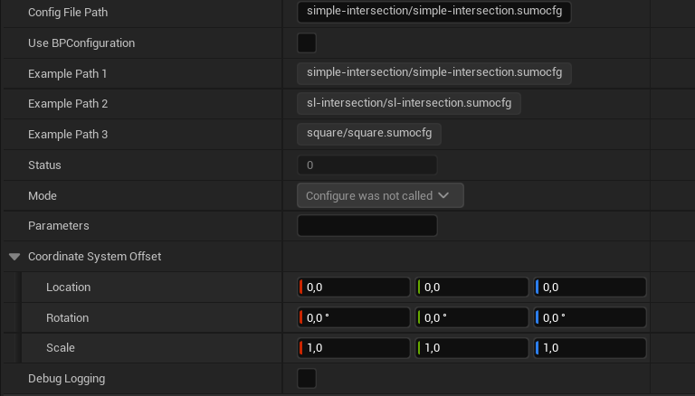

# GEMSTAR UE_SUMO_Plugin

[](https://www.dlr.de/en/ts/about-us/the-institute-of-transportation-systems)

This plugin adds [SUMO](https://github.com/eclipse-sumo/sumo) in version `1.27.1` to GEMSTAR.
SUMO simulates a scenario and sends information to GEMSTAR.

## Input

- SUMO simulation configuration (.sumocfg)
- additional configuration files

## Output

- Vehicle Data
- Traffic Light Data
- VRU Data
- Weather configuration

# Getting started

First clone the GEMSTAR Interfaces plugin inside the Plugins directory.

Add the plugin to your Unreal project:

```sh
mkdir Plugins/GameFeatures
cd Plugins/GameFeatures

git clone https://github.com/DLR-TS/ue_sumo_feature.git
```
or:
```sh
git submodule add https://github.com/DLR-TS/ue_sumo_feature.git
```

## Third-party dependencies

Linux artefacts are built through Docker:

```sh
./Scripts/build-dependencies.sh
```

Windows artefacts are built natively with Git, CMake, Visual Studio 2022, and vcpkg:

```powershell
.\Scripts\build-dependencies.ps1
```

Convert an OpenDRIVE to a SUMO map to run with GEMSTAR:

```
netconvert --opendrive-files Map.xodr --offset.disable-normalization true --proj.rotate 270 -o Map.net.xml
```

# Configuration

You can configure the sumocfg file to be played by setting the Path variable of SUMOManager actor. 

Otherwise if DefaultGemstar.ini file has a section called __ue_sumo_feature__ there are two parameters:
- Debug=true/false enables verbose logging in the ue logs
- Parameters is a string with sumo options that are passed on libsumo. 

For the argument -c or --configuration-file the value can be an asolute or relative file path to Gemstar/Simulation/SUMO.

### Weather informations

This plugin tries to get weather information from a OpenSCENARIO Environment tag. When the scenario is loading  by the EsminiManager it looks for a this tag in two different places in the follow order:

- A file with the name pattern weather_<scenario_name>.xml in the same folder as the scenario file. E.g. cut-in.xosc would look for weather_cut-in.xml.
- Any file that follow the name pattern weather_*.xml in the same folder as the scenario file. The use case is on weather information for different scenarios.

When there is a weather information, EsminiManager will send a FWeatherData message to every plugin that has GEMSTARInterfaceType::WEATHERDATA as input.

# Test



**Path** SUMO configuration file (.sumocfg)\
**Status** Status of library [Unset, Configured, Running, Done]\
**Coordinate System Offset** Additional offset (if needed)

---------------
**Contact:** opensource-ts@dlr.de

This project uses [Eclipse SUMO](https://github.com/eclipse-sumo/sumo), which is licensed under the Eclipse Public License 2.0.

This project uses the Open Simulation Interface ([OSI](https://github.com/OpenSimulationInterface/open-simulation-interface)), which is licensed under the
Mozilla Public License 2.0.
